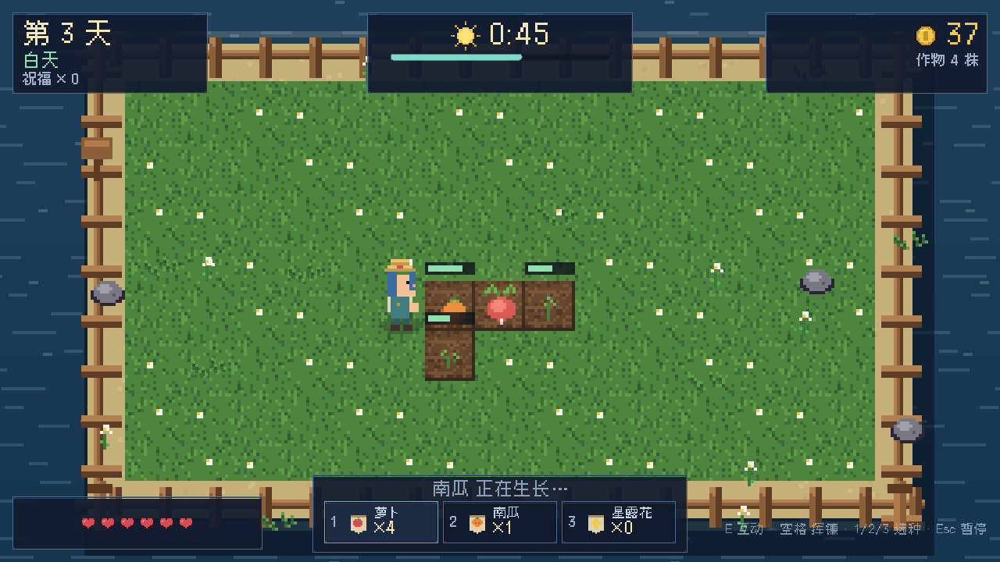
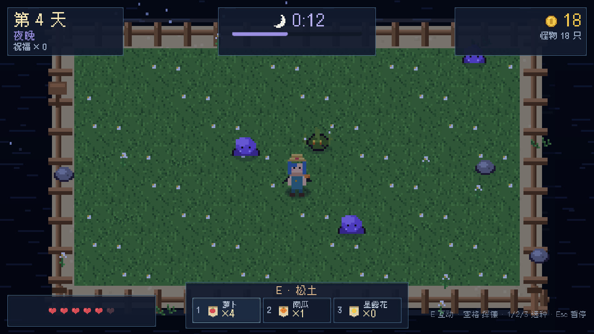
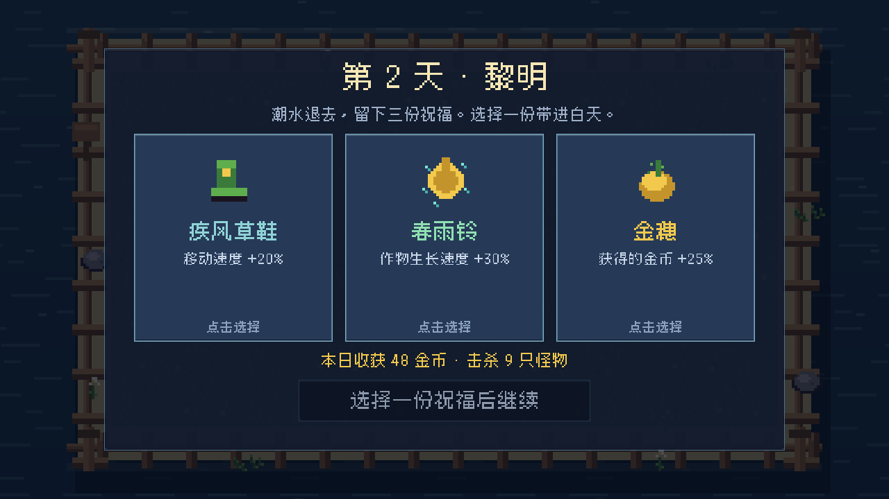

# 鲸落农场 · Whale Fall Farm

一个用 **Godot 4.7** 制作的小游戏：**农场经营 + Roguelike**。
白天在鲸背上种田，夜晚抵御从潮水里爬上来的怪物；每天黎明从三份「潮汐祝福」里选一份，撑过七天。

> 全部像素美术、背景音乐与音效都由仓库内的 Python 脚本程序化生成，没有任何外部素材包。






## 玩法

- **白天（75 秒）**：走到田里，按 `E` 松土 → 播种 → 浇水 → 收获。作物只在浇过水之后生长。
- **夜晚**：潮水带来史莱姆、偷穗鸦和缠根怪。用镰刀清场；乌鸦会优先啃食成熟的作物。
- **黎明**：从三份随机祝福中选一份（移速、攻击、生长、吸血、反伤……），带进下一天。
- **目标**：撑过第 7 个夜晚。死亡即结束本局，最佳记录保存在本地。
- 地图装饰、夜间波次、黎明祝福都是随机的，所以每一局都不一样。

## 操作

| 按键 | 作用 |
| --- | --- |
| `WASD` / 方向键 | 移动 |
| `E` | 互动：松土 / 播种 / 浇水 / 收获 |
| `1` `2` `3` | 切换种子（萝卜 / 南瓜 / 星露花） |
| `空格` / 鼠标左键 | 挥镰攻击（鼠标会朝指针方向挥） |
| `Esc` | 暂停 |
| `F` | 全屏切换 |

## 运行

### 直接玩（推荐）

到 [Releases](https://github.com/ElectLive/whale-fall-farm/releases) 下载 `WhaleFallFarm-v0.1.0-win64.zip`，解压后双击 `WhaleFallFarm.exe`。
存档写在 exe 旁边，绿色免安装。

### 用 Godot 打开

需要 **Godot 4.7**（标准版，非 .NET）：

```bash
godot --path .
```

或者把本目录导入 Godot 项目管理器，按 F5。

## 从源码重新生成素材

```bash
python tools/gen_art.py     # 65 张像素图 + 图标（需要 Pillow）
python tools/gen_audio.py   # 3 首循环 BGM + 12 个音效（需要 numpy）
```

脚本是确定性的：同一个脚本每次生成同样的素材，方便 diff 和复现。

## 开发自检

```bash
# 无头逻辑测试：种田链路、昼夜切换、祝福、存档
Godot --headless --path . -- --selftest

# 实时冒烟测试：真的种一轮、打一夜、进入黎明
Godot --headless --path . -- --smoke

# 截图（输出到 screenshots/）
Godot --path . -- --shot=title
Godot --path . -- --shot=day
Godot --path . -- --shot=night
Godot --path . -- --shot=dawn
```

导出 Windows 版：

```bash
Godot --headless --path . --export-release "Windows Desktop" build/windows/WhaleFallFarm.exe
```

## 项目结构

```
assets/
  font/                 Cubic 11 像素字体（OFL）
  generated/            由脚本生成的图、音、图标
scripts/
  main.gd               游戏状态机、昼夜循环、战斗、经济、存档钩子
  farm.gd / crop.gd     农田网格与作物生长
  player.gd / enemy.gd  玩家与三种怪物
  sea.gd / island.gd    鲸背小岛与海面
  hud.gd                游戏内 HUD
  title_screen.gd       标题界面
  dawn_screen.gd        黎明祝福三选一
  end_screen.gd         结算界面
  pause_screen.gd       暂停界面
  audio.gd              音乐/音效自动加载
  save_game.gd          本地记录
  dev.gd                selftest / smoke / 截图钩子
tools/
  gen_art.py            程序化像素美术
  gen_audio.py          程序化 chiptune 音乐与音效
docs/
  design.md             设计文档与数值表
  devlog.md             版本日志与验证记录
  art_preview.png       素材总览
```

## 设计备注

- 分辨率 1280×720，相机固定 4 倍缩放，保证像素对齐；UI 使用 12px 像素字体 Cubic 11。
- 美术全部以 16×16 为基础手写绘制代码；角色 16×24，4 方向 4 帧。
- 音乐是 numpy 合成的方波/三角波/噪声，按和弦进行生成，WAV 循环播放。
- 数值（作物价格、怪物血量、波次）集中在 `scripts/data.gd`，方便调整。

## 版本

- **v0.1.0** — 完整核心循环：种田、昼夜、三种怪物、12 种祝福、7 天胜利、结算与本地最佳记录、程序化美术与音乐、自动化测试与截图。

## License

- 代码：MIT，见 [LICENSE](LICENSE)。
- 程序生成的图像与音频：CC0-1.0（可随意使用）。
- 字体：[Cubic 11](https://github.com/ACh-K/Cubic-11)，SIL Open Font License 1.1，见 [assets/font/OFL.txt](assets/font/OFL.txt)。

---

用 [DeepSeek Harness](https://github.com/deepseek-ai/dsh) 制作。美术与音乐没有借助任何外部素材。
