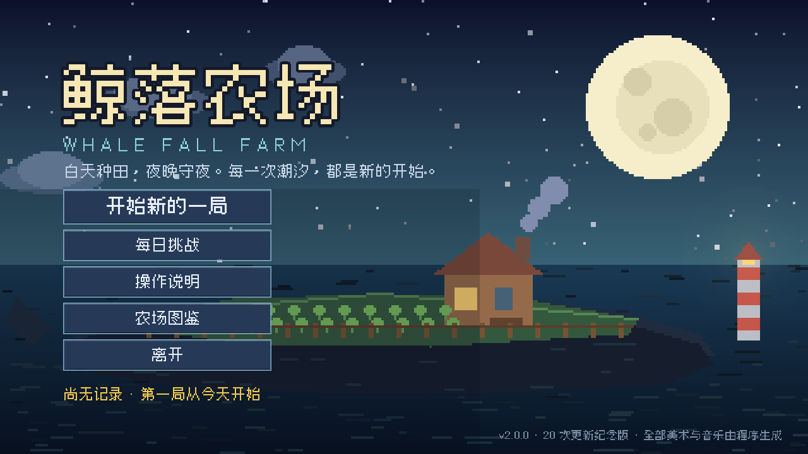
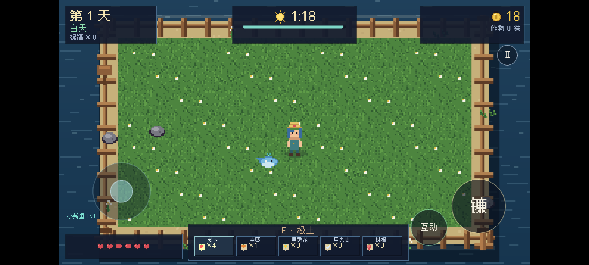
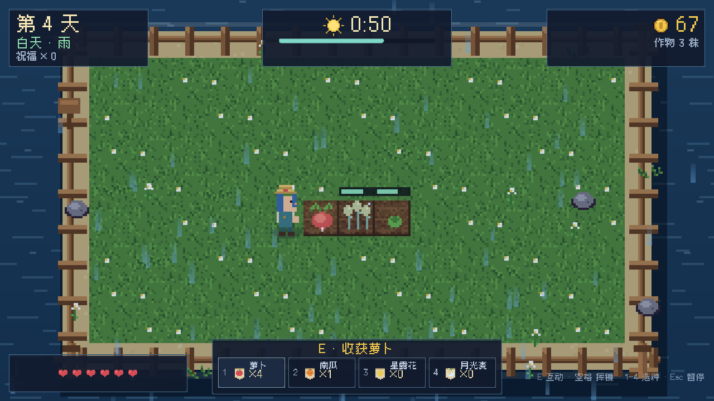
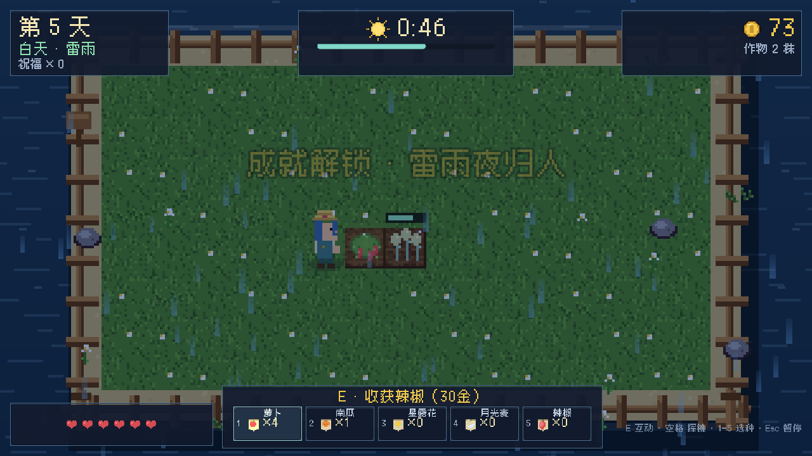
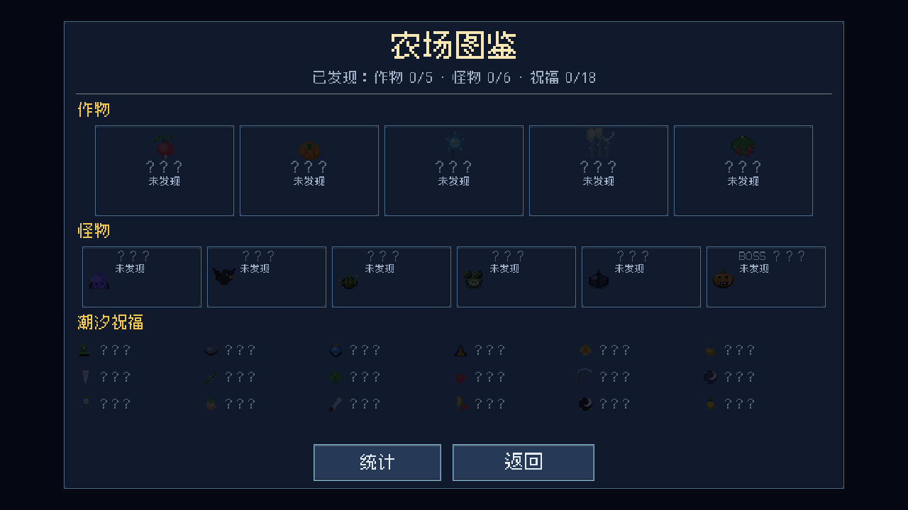
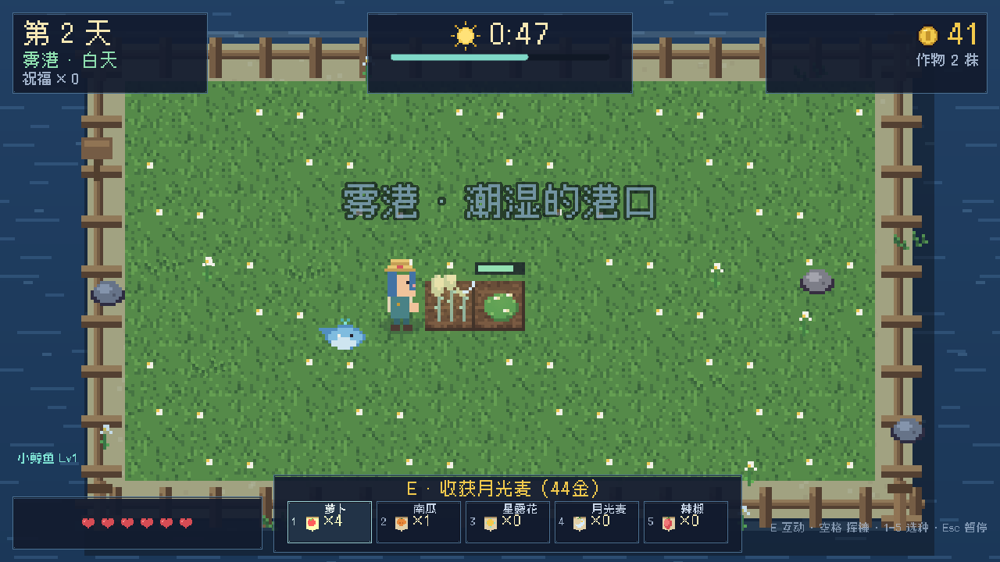
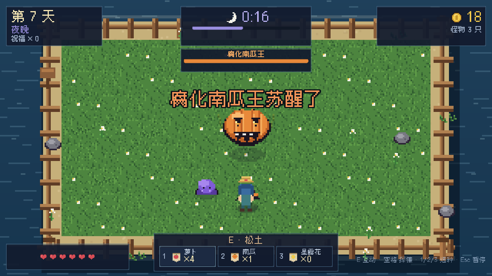

# 鲸落农场 · Whale Fall Farm

一个用 **Godot 4.7** 制作的小游戏：**农场经营 + Roguelike**。
白天在鲸背上种田，夜晚抵御从潮水里爬上来的怪物；每天黎明挑一份「潮汐祝福」、逛一次潮汐商店，撑过七个夜晚。

支持 **Windows 桌面** 和 **Android 手机**（横屏触控）。
全部像素美术、背景音乐与音效都由仓库内的 Python 脚本程序化生成，没有任何外部素材包。









## 玩法

- **白天（75 秒）**：走到田里，按互动键松土 → 播种 → 浇水 → 收获。作物只在浇过水之后生长。
- **天气**：每天有雨天、雾天、雷雨等随机天气。雨天/雷雨会自动浇灌所有作物（包括新种下的）；雾天视野变灰；雷雨会闪电并配雨声。
- **夜晚**：潮水带来史莱姆、偷穗鸦、缠根怪、沼泽蛙和铁甲虫。用镰刀清场；乌鸦会优先啃食成熟的作物。萤火虫会飘在田上。
- **黎明**：三选一随机祝福，然后可以在**潮汐商店**用金币买种子、回血、加生命上限。
- **成就**：8 个成就（首收、50 收、50 杀、第 5 天、Boss、无尽 10 天、金色作物、雷雨）解锁时弹横幅并写入存档。
- **农场图鉴 / 统计**：标题界面打开图鉴，查看已发现的作物、怪物、祝福；统计页记录游玩局数、最佳天数、累计收获/击杀/金币。
- **第二张地图「雾港」**：通关过一局后，约 30% 的局会进入雾港——冷色调、淡雾、作物生长 +15%，夜里多一只怪。
- **每日挑战**：标题界面按当天日期生成固定种子，同一天所有玩家地形/天气/祝福一致；本地记录每日最佳天数。
- **小鲸鱼**：开局跟随玩家，自动攻击附近的怪物；收获作物会让它成长（每 10 个收获升 1 级，等级显示在左下）。
- **设置**：暂停菜单可关震屏、弱化闪光、开自动瞄准；手机端还有震动开关。
- **第 7 夜**：腐化南瓜王苏醒。它会吐种子弹、在血量过半和残血时召唤潮泥怪；打倒它才能迎来胜利。
- **无尽模式**：通关后可以继续。每 3 天再战一次南瓜王，怪潮越来越厚，直到农场沉没。最佳纪录按存活天数结算。
- 地图装饰、天气、夜间波次、祝福与商店都是随机的，所以每一局都不一样。

## 作物

| 作物 | 种子价 | 生长 | 售价 | 特点 |
| --- | --- | --- | --- | --- |
| 萝卜 | 3 | 7s | 9 | 回本快 |
| 南瓜 | 9 | 13s | 24 | 稳健 |
| 星露花 | 20 | 20s | 54 | 最贵 |
| 月光麦 | 16 | 9s（仅夜晚） | 44 | 白天打盹，夜里疯长 |
| 辣椒 | 11 | 11s | 30 | 中价中速，补空档 |

## 操作

### Windows

| 按键 | 作用 |
| --- | --- |
| `WASD` / 方向键 | 移动 |
| `E` | 互动：松土 / 播种 / 浇水 / 收获 |
| `1` `2` `3` `4` `5` | 切换种子（也可直接点种子栏） |
| `空格` / 鼠标左键 | 挥镰攻击（鼠标会朝指针方向挥） |
| `Esc` | 暂停（内有音乐 / 音效 / 全屏开关） |
| `M` | 快速开关音乐 |
| `F` | 全屏切换 |

### Android

- **左侧摇杆**：移动。
- **右侧「镰」**：挥镰，可长按连续攻击。
- **「互动」**：松土 / 播种 / 浇水 / 收获。
- **底部种子栏**：轻点切换种子（当前选中的格子会变亮）。
- **右上「Ⅱ」**：暂停；系统返回键同样打开暂停/继续。
- 游戏锁定横屏；16:9 内容居中，超宽屏两侧留黑边。

## 下载

到 [Releases](https://github.com/ElectLive/whale-fall-farm/releases) 下载最新版：

- Windows：`WhaleFallFarm-v2.0.0-win64.zip` — 解压双击 `WhaleFallFarm.exe`，绿色免安装，存档在 exe 旁边。
- Android：`WhaleFallFarm-v2.0.0-android.apk` — Android 7.0+ / arm64，允许「安装未知来源应用」即可安装。APK 使用调试证书签名，适合直接安装试玩，不适合上架应用商店。

## 从源码运行

### Windows / 编辑器

需要 **Godot 4.7**（标准版，非 .NET）：

```bash
godot --path .
```

### 导出 Windows

```bash
Godot --headless --path . --export-release "Windows Desktop" build/windows/WhaleFallFarm.exe
```

### 导出 Android APK

需要：

- Godot 4.7 Android 导出模板（`android_debug.apk` / `android_release.apk`）
- JDK 17
- Android SDK：`build-tools;34.0.0`、`platforms;android-35`

设置 `JAVA_HOME`、`ANDROID_HOME`（或 Godot 编辑器设置里的 Android SDK 路径），并准备调试证书，然后：

```bash
Godot --headless --path . --export-release "Android" build/android/WhaleFallFarm.apk
```

## 从源码重新生成素材

```bash
python tools/gen_art.py     # 88 张像素图 + 图标（需要 Pillow）
python tools/gen_audio.py   # 4 首循环 BGM + 17 个音效 + 1 条雨声（需要 numpy）
```

脚本是确定性的：同一个脚本每次生成同样的素材，方便 diff 和复现。

## 开发自检

```bash
# 无头逻辑测试：种田、昼夜、商店、祝福、Boss、无尽、天气、移动端触控、存档
Godot --headless --path . -- --selftest     # 71/71 PASS

# 实时冒烟测试：真的种一轮、传送到怪身边砍死几只、进入黎明
Godot --headless --path . -- --smoke

# 截图（输出到 screenshots/）
Godot --path . -- --shot=title   # title / day / night / rain / boss / dawn / shop / pause / mobile / victory / endless / gameover
```

## 项目结构

```
assets/
  font/                 Cubic 11 像素字体（OFL）
  generated/            由脚本生成的图、音、图标
scripts/
  main.gd               游戏状态机、昼夜循环、战斗、商店、经济、存档钩子
  farm.gd / crop.gd     农田网格与作物生长
  player.gd / enemy.gd  玩家与怪物（含南瓜王）
  projectile.gd         南瓜王吐出的种子
  sea.gd / island.gd    鲸背小岛与海面
  hud.gd                HUD、Boss 血条、横幅提示、低血量红框
  mobile_controls.gd    手机虚拟摇杆与触控按钮
  pet.gd                小鲸鱼宠物（跟随/自动攻击/升级）
  codex_screen.gd       农场图鉴与终身统计
  title_screen.gd       标题界面
  dawn_screen.gd        黎明祝福三选一 + 潮汐商店
  end_screen.gd         结算界面
  pause_screen.gd       暂停 + 音频/全屏设置
  audio.gd              音乐/音效/雨声环境音
  save_game.gd          本地记录与设置
  dev.gd                selftest / smoke / 截图钩子
tools/
  gen_art.py            程序化像素美术
  gen_audio.py          程序化 chiptune 音乐与音效
docs/
  design.md             设计文档与数值表
  devlog.md             版本日志与验证记录
  art_preview.png       素材总览
```

## 设计备注

- 分辨率 1280×720，相机固定 4 倍缩放，保证像素对齐；手机端 16:9 内容居中显示。
- 美术全部以 16×16 为基础手写绘制代码；角色 16×24，4 方向 4 帧；Boss 32×32。
- 音乐是 numpy 合成的方波/三角波/噪声，按和弦进行生成，WAV 循环播放；第 7 夜有独立 Boss 曲。
- 数值（作物价格、怪物血量、波次、商店价格）集中在 `scripts/data.gd`，方便调整。
- 手机触控与键鼠共用同一套状态机：虚拟摇杆写入移动向量，触控按钮直接调用互动/攻击/暂停。
- Android 存档写入 `user://`（应用私有目录）；Windows 便携版写在 exe 旁边。

## 版本

- **v0.1.0** — 完整核心循环：种田、昼夜、三种怪物、12 种祝福、7 天胜利、结算与本地最佳记录。
- **v0.2.0** — 黎明潮汐商店；第 7 夜 Boss「腐化南瓜王」；横幅、粒子、新音效。
- **v0.3.0** — 音乐/音效/全屏设置；2 个新祝福；Boss 专属 BGM 与胜负音效；夜晚萤火虫、低血量红框。
- **v1.0.0** — 无尽模式（通关后继续，每 3 天再战南瓜王）；记录/最佳成绩继续更新。
- **v1.1.0** — 第 4 种作物「月光麦」；新怪物「沼泽蛙」；雨天天气；4 格种子栏。
- **v1.2.0** — **Android 适配与 APK**：虚拟摇杆、触控攻击/互动/暂停、可点选种子栏、返回键暂停、手机存档路径；Windows 版同步。
- **v1.3.0** — 第 5 种作物「辣椒」+ 5 格种子栏；金色作物变异（3 倍售价）；手机震动与切后台自动暂停；农事 QoL（种子用完自动切换、收获金额提示）。
- **v1.4.0** — 4 个新祝福（暴击/收割回血/夜战/点金手）；新怪物「铁甲虫」（护甲减伤）；雾天与雷雨天气（闪电、雨声、自动浇水）；8 个成就与解锁横幅。
- **v1.5.0** — 农场图鉴与终身统计；无尽 Boss 词缀（狂暴/再生/召唤）；精英怪（双倍生命与金币）；图鉴/统计界面。
- **v1.6.0** — 每日挑战（日期种子）；小鲸鱼宠物（跟随/自动攻击/成长）；震屏、闪光弱化、自动瞄准设置；暂停菜单两行设置。
- **v2.0.0** — 20 次更新完成：小鲸鱼等级与喂养成长、第二张地图「雾港」、移动端粒子降级/FPS 上限/存档版本迁移、最终平衡（白天 80 秒）与完整文档。

## 20 次更新记录

| 批次 | 内容 | 发布 |
| --- | --- | --- |
| 01–04 | 手机震动/自动暂停、农事 QoL、辣椒 + 5 格种子栏、金色作物 | [v1.3.0](https://github.com/ElectLive/whale-fall-farm/releases/tag/v1.3.0) |
| 05–08 | 4 个新祝福、铁甲虫、雾/雷雨天气、8 个成就 | [v1.4.0](https://github.com/ElectLive/whale-fall-farm/releases/tag/v1.4.0) |
| 09–12 | 农场图鉴、终身统计、无尽 Boss 词缀、精英怪 | [v1.5.0](https://github.com/ElectLive/whale-fall-farm/releases/tag/v1.5.0) |
| 13–16 | 每日挑战、震屏/闪光/自动瞄准、小鲸鱼宠物 | [v1.6.0](https://github.com/ElectLive/whale-fall-farm/releases/tag/v1.6.0) |
| 17–20 | 宠物等级、雾港地图、移动端性能、v2.0.0 完整版 | [v2.0.0](https://github.com/ElectLive/whale-fall-farm/releases/tag/v2.0.0) |

## License

- 代码：MIT，见 [LICENSE](LICENSE)。
- 程序生成的图像与音频：CC0-1.0（可随意使用）。
- 字体：[Cubic 11](https://github.com/ACh-K/Cubic-11)，SIL Open Font License 1.1，见 [assets/font/OFL.txt](assets/font/OFL.txt)。

---

用 [DeepSeek Harness](https://github.com/deepseek-ai/dsh) 制作。美术与音乐没有借助任何外部素材。
